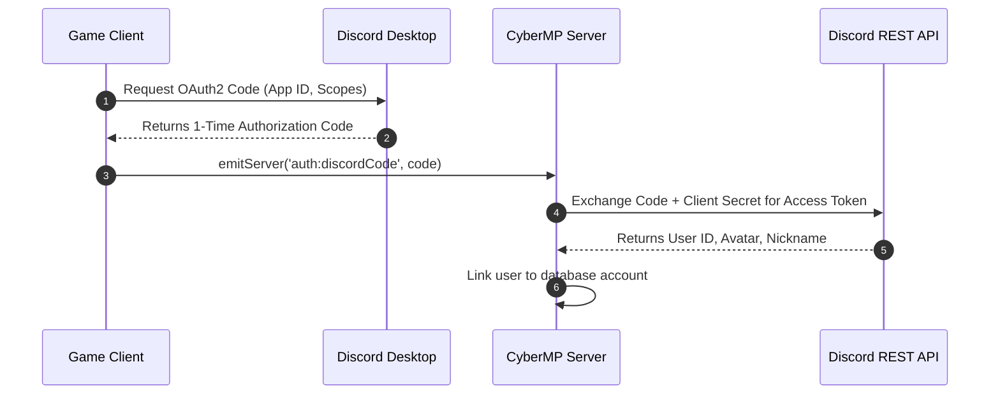

import { Tabs, TabItem } from '@astrojs/starlight/components';
import { SCRIPT_LANG_TAB_SYNC_KEY } from '../../../../lib/const';

The client runtime provides integration with the Discord desktop client via `mp.discord`. This allows your server to display real-time activity (current district, mission, role) on players' Discord profiles and securely authenticate player accounts via Discord OAuth2.

In this guide, you will learn how to update Rich Presence and execute OAuth2 authentication flows in JavaScript and Lua.

---

## Rich Presence

Rich Presence allows you to update the status text displayed under the player's Discord profile card:

<Tabs syncKey={SCRIPT_LANG_TAB_SYNC_KEY}>
  <TabItem label="JS">
    ```js title="client.js"
    // Update presence: (state, details)
    mp.discord.updateRichPresence('Exploring Night City', 'Cruising through Heywood');

    // Reset presence text
    mp.discord.updateRichPresence();
    ```
  </TabItem>
  <TabItem label="Lua">
    ```lua title="client.lua"
    -- Update presence table
    mp.discord.setActivity({
      state = "Exploring Night City",
      details = "Cruising through Heywood"
    })

    -- Reset presence
    mp.discord.clearActivity()
    ```
  </TabItem>
</Tabs>

:::tip
Call Rich Presence updates when significant gameplay context changes (such as entering a new district, beginning a combat encounter, or entering an apartment). Avoid updating Rich Presence faster than every 15-20 seconds to prevent rate-limiting by Discord.
:::

---

## Discord OAuth2 Authentication

To verify player identities or link Discord accounts without asking users for login credentials, request a Discord authorization code.

The client runtime requests the code asynchronously from the Discord Game SDK running on the user's machine:

<Tabs syncKey={SCRIPT_LANG_TAB_SYNC_KEY}>
  <TabItem label="JS">
    ```js title="client.js"
    const DISCORD_APP_ID = '123456789012345678';
    const SCOPES = JSON.stringify(['identify', 'guilds']);

    let authTimer = null;

    const requestDiscordAuth = () => {
      authTimer = mp.setInterval(() => {
        // Returns empty string until the user approves or code is delivered
        const code = mp.discord.getCodeAuthorization(DISCORD_APP_ID, SCOPES);

        if (code && code.length > 0) {
          mp.clearInterval(authTimer);
          console.log('[Discord] Auth code received. Forwarding to server...');

          // Send the code to your server to exchange for user profile
          mp.events.emitServer('auth:discordCode', code);
        }
      }, 1000);
    };

    mp.commands.add('link-discord', requestDiscordAuth);
    ```
  </TabItem>
  <TabItem label="Lua">
    ```lua title="client.lua"
    local DISCORD_APP_ID = '123456789012345678'
    local SCOPES = '["identify", "guilds"]' -- Must be a JSON array string

    local function requestDiscordAuth()
      mp.setInterval(function()
        -- Returns empty string until the user approves or code is delivered
        local code = mp.discord.getOAuth2Code(DISCORD_APP_ID, SCOPES)

        if code and #code > 0 then
          print("[Discord] Auth code received. Forwarding to server...")

          -- Send the code to your server to exchange for user profile
          mp.events.triggerServer('auth:discordCode', code)
          return false -- Stop interval
        end
      end, 1000)
    end

    mp.commands.add('link-discord', requestDiscordAuth)
    ```
  </TabItem>
</Tabs>

### Security Architecture



:::caution[Never Expose Client Secrets]
Never put your Discord application `client_secret` in client-side code. The client script only receives the temporary authorization code; your server backend must perform the token exchange with Discord's REST API.
:::
