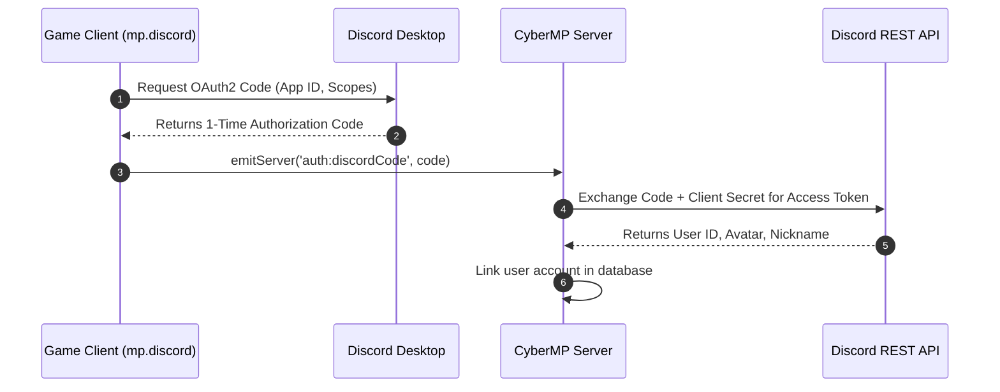

import { Tabs, TabItem } from '@astrojs/starlight/components';
import { SCRIPT_LANG_TAB_SYNC_KEY } from '../../../../lib/const';

The client runtime integrates with the Discord desktop app via the `mp.discord` interface. This allows your server to display dynamic status information (such as district, active gig, or faction) on players' Discord profile cards, and securely authenticate player accounts through Discord OAuth2 without asking for login credentials.

For full method signatures, see the [`MpDiscord`](/reference/client/api/global/mpdiscord/) API reference and the [Lua Client Reference](/reference/lua/client/#discord-integration-mpdiscord).

---

## Rich Presence

Rich Presence updates the status text displayed under the player's Discord profile card:

<Tabs syncKey={SCRIPT_LANG_TAB_SYNC_KEY}>
  <TabItem label="JS">
    ```js title="client.js"
    // Update presence: (state, details)
    mp.discord.updateRichPresence('Exploring Night City', 'Cruising through Heywood');

    // Reset presence text (retains CyberMP badge and timer)
    mp.discord.updateRichPresence();
    ```
  </TabItem>
  <TabItem label="Lua">
    ```lua title="client.lua"
    -- Update presence table
    mp.discord.setActivity({
      state = "Exploring Night City",
      details = "Cruising through Heywood"
    })

    -- Reset presence
    mp.discord.clearActivity()
    ```
  </TabItem>
</Tabs>

- **`state`** and **`details`**: Optional strings describing the player's current activity. Missing arguments clear the text.
- **Clearing presence**: Calling `updateRichPresence()` without arguments in JavaScript (or `clearActivity()` in Lua) resets the custom status lines while keeping the CyberMP application card and playtime counter visible.

:::tip[Rate Limiting]
Discord rate-limits Rich Presence updates. Update status when significant events occur (such as switching districts or starting missions), avoiding updates faster than every 15–20 seconds.
:::

---

## Discord OAuth2 Authentication

To verify player identity or link Discord accounts, request a one-time authorization code from the Discord client running on the user's system:

<Tabs syncKey={SCRIPT_LANG_TAB_SYNC_KEY}>
  <TabItem label="JS">
    ```js title="client.js"
    const DISCORD_APP_ID = '123456789012345678';
    const SCOPES = JSON.stringify(['identify', 'guilds']);

    let authTimer = null;

    const requestDiscordAuth = () => {
      authTimer = mp.setInterval(() => {
        // Asynchronous: returns empty string until the user approves
        const code = mp.discord.getCodeAuthorization(DISCORD_APP_ID, SCOPES);

        if (code && code.length > 0) {
          mp.clearInterval(authTimer);
          authTimer = null;
          console.log('[Discord] Auth code received. Forwarding to server...');

          // Forward code to the server to exchange for user profile
          mp.events.emitServer('auth:discordCode', code);
        }
      }, 1000);
    };

    mp.commands.add('link-discord', requestDiscordAuth);
    ```
  </TabItem>
  <TabItem label="Lua">
    ```lua title="client.lua"
    local DISCORD_APP_ID = '123456789012345678'
    local SCOPES = '["identify", "guilds"]' -- Must be a JSON array string

    local authTimer = nil

    local function requestDiscordAuth()
      authTimer = mp.setInterval(function()
        -- Asynchronous: returns empty string until the user approves
        local code = mp.discord.getOAuth2Code(DISCORD_APP_ID, SCOPES)

        if code and #code > 0 then
          mp.clearInterval(authTimer)
          authTimer = nil
          print("[Discord] Auth code received. Forwarding to server...")

          -- Forward code to the server to exchange for user profile
          mp.events.triggerServer('auth:discordCode', code)
        end
      end, 1000)
    end

    mp.commands.add('link-discord', requestDiscordAuth)
    ```
  </TabItem>
</Tabs>

### Authorization Flow Details

- **`getCodeAuthorization(appId, scopes)`** (Lua: `getOAuth2Code`): Requests an authorization code. It is asynchronous and non-blocking—it returns an empty string `""` on initial calls and until the user approves the prompt in Discord.
- **`scopes`**: Must be a JSON-encoded string array (e.g. `'["identify", "guilds"]'`), not comma-separated text.
- **Direct Access Token**: If your client needs a direct token from the Discord Game SDK instead of exchanging on the server, you can call `mp.discord.getOAuth2Token(appId)`. Like the authorization call, it returns an empty string until resolved.
- **Discord Desktop Required**: If Discord is not running on the client machine, these methods continually return `""`. Always guard the polling interval with a timeout.



:::caution[Never Expose Client Secrets]
Never put your Discord application `client_secret` in client-side code. The client script only retrieves the temporary authorization code; your server backend must perform the token exchange with Discord's REST API.
:::
