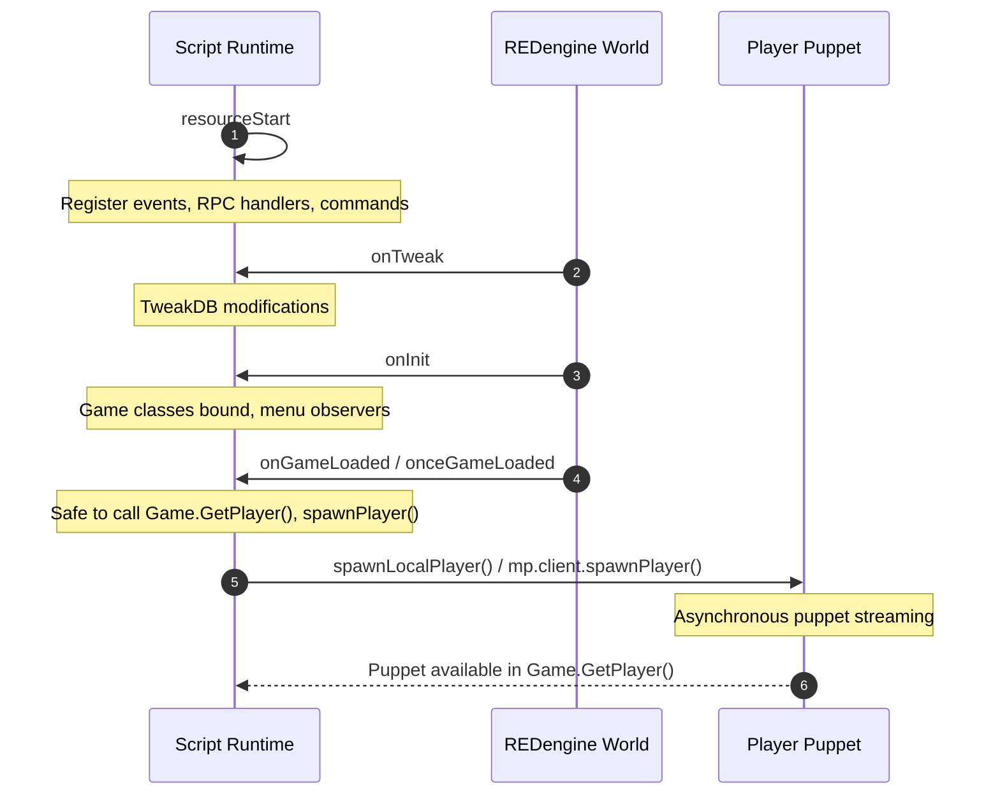

import { Tabs, TabItem } from '@astrojs/starlight/components';
import { SCRIPT_LANG_TAB_SYNC_KEY } from '../../../../lib/const';

When a client launches or reconnects, scripts initialize before the 3D world is loaded. Attempting to query the player, access world systems, or teleport inside `resourceStart` will fail or return `null`.

In this guide, you will learn the exact order of client lifecycle stages, what actions are safe at each stage, and how to safely wait for the player puppet.

---

## Lifecycle Stages Overview



---

## Stage Reference

| Stage | JavaScript API | Lua API | Safe to Execute | Unsafe to Execute |
| :--- | :--- | :--- | :--- | :--- |
| **`resourceStart`** | `mp.events.on('resourceStart', fn)` | `mp.events.add('resourceStart', fn)` | Register events, RPC handlers, commands | Any REDengine native calls |
| **`onTweak`** | `mp.game.onTweak(fn)` | `mp.registerGameState('onTweak', fn)` | Read/write TweakDB records and flats | Assuming the player puppet exists |
| **`onInit`** | `mp.game.onInit(fn)` | `mp.registerGameState('onInit', fn)` | Early hooks, menu observers | World entity queries |
| **`onGameLoaded`** | `mp.game.onGameLoaded(fn)` / `onceGameLoaded(fn)` | `mp.registerGameState('onGameLoaded', fn)` | Retrieve `GetPlayer()`, systems, spawn routines | Assuming puppet exists synchronously |
| **`resourceStop`** | `mp.events.on('resourceStop', fn)` | `mp.events.add('resourceStop', fn)` | Release CEF focus, clear intervals/ticks | Long-running asynchronous operations |

:::note[Post-Load Execution]
If a client resource starts or restarts when the game is *already* loaded, handlers for `onInit` and `onGameLoaded` run on the very first script tick.
:::

---

## Safe Initialization Pattern

Keep event registration immediate, but defer world interactions until `onGameLoaded`:

<Tabs syncKey={SCRIPT_LANG_TAB_SYNC_KEY}>
  <TabItem label="JS">
    ```js title="client.js"
    // 1. Immediate: Register network listeners and commands
    mp.events.onServer('serverNotification', (msg) => {
      console.log('[Server]:', msg);
    });

    mp.commands.add('ping', () => {
      console.log('Client script active.');
    });

    // 2. World Ready: Safe to query player and world systems
    mp.game.onceGameLoaded(() => {
      const player = mp.game.GetPlayer();
      console.log('World loaded, local player handle:', player?.GetEntityID());

      // Trigger safe spawn
      mp.setSpawnDataLocalPlayer(-1392.6, 1271.5, 123.0, 1.0);
      mp.spawnLocalPlayer();
    });
    ```
  </TabItem>
  <TabItem label="Lua">
    ```lua title="client.lua"
    -- 1. Immediate: Register network listeners and commands
    mp.events.addServer('serverNotification', function(msg)
      print("[Server]: " .. msg)
    end)

    mp.commands.add('ping', function()
      print("Client script active.")
    end)

    -- 2. World Ready: Safe to query player and world systems
    mp.registerGameState('onGameLoaded', function()
      local player = Game.GetPlayer()
      print("World loaded, local player ready:", player ~= nil)

      -- Trigger safe spawn
      mp.client.spawnPlayer(-1392.6, 1271.5, 123.0, 1.0)
    end)
    ```
  </TabItem>
</Tabs>

---

## Polling for the Player Puppet

Calling the spawn method initiates asynchronous entity streaming. The player puppet might not be available on the exact frame the call returns `true`. 

When applying custom appearances, stat modifications, or inventory items right after spawn, poll until `GetPlayer()` returns a valid instance:

<Tabs syncKey={SCRIPT_LANG_TAB_SYNC_KEY}>
  <TabItem label="JS">
    ```js title="client.js"
    const waitForPlayer = async (timeoutMs = 10000) => {
      const start = Date.now();
      while (Date.now() - start < timeoutMs) {
        const player = mp.game.GetPlayer();
        if (player) return player;
        await new Promise((resolve) => setTimeout(resolve, 50));
      }
      return null;
    };

    mp.game.onceGameLoaded(async () => {
      mp.setSpawnDataLocalPlayer(-1392.6, 1271.5, 123.0, 1.0);
      mp.spawnLocalPlayer();

      const player = await waitForPlayer();
      if (player) {
        console.log('Player entity fully ready for customization.');
      }
    });
    ```
  </TabItem>
  <TabItem label="Lua">
    ```lua title="client.lua"
    local function waitForPlayer(timeoutMs)
      local start = mp.getTimer()
      timeoutMs = timeoutMs or 10000

      while mp.getTimer() - start < timeoutMs do
        local player = Game.GetPlayer()
        if player then return player end
        mp.wait(50) -- Requires coroutine/scheduler context
      end
      return nil
    end

    mp.registerGameState('onGameLoaded', function()
      mp.client.spawnPlayer(-1392.6, 1271.5, 123.0, 1.0)

      -- Run wait in a task
      mp.events.trigger('task:initPlayer')
    end)
    ```
  </TabItem>
</Tabs>
