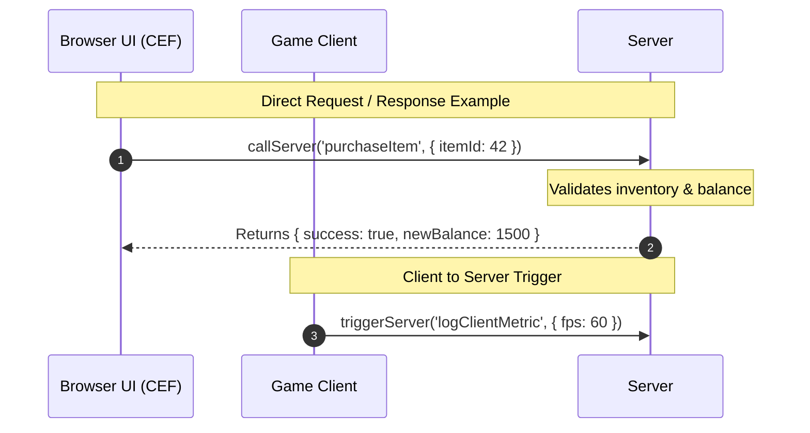

import { Tabs, TabItem } from '@astrojs/starlight/components';

Standard network events are fire-and-forget: the sender emits a packet but cannot directly receive a return value. When building interactive user interfaces, inventory menus, or database queries where you need to `await` a response, use the official `@cybermp/rpc` library suite.

In this guide, you will learn how to set up RPC handlers, invoke methods across boundaries, and exchange data seamlessly between the server, game client, and CEF browser UI.

---

## RPC Packages

Install the appropriate package for each target environment:

| Package | Environment | Purpose |
| :--- | :--- | :--- |
| [`@cybermp/rpc-server`](https://www.npmjs.com/package/@cybermp/rpc-server) | Server scripts | Handle requests from clients and call into client/browser instances. |
| [`@cybermp/rpc-client`](https://www.npmjs.com/package/@cybermp/rpc-client) | Game client scripts | Bridge requests between server and browser, handle client methods. |
| [`@cybermp/rpc-browser`](https://www.npmjs.com/package/@cybermp/rpc-browser) | CEF web pages | Handle UI requests and directly call server/client procedures. |

```bash
npm install @cybermp/rpc-server @cybermp/rpc-client @cybermp/rpc-browser
```

:::note[Bundling Client Scripts]
Because game client scripts and CEF browser pages run in isolated runtime environments without native `node_modules` resolution, bundle `@cybermp/rpc-client` and `@cybermp/rpc-browser` into your distribution output using `esbuild`, `tsdown`, or `bun`.
:::

---

## Two Kinds of Calls

| Purpose | Handler Registration | Invocation Method |
| :--- | :--- | :--- |
| **Request & Response** (await result) | `rpc.register('name', handler)` | `callServer` / `callClient` / `callBrowser` |
| **Fire-and-Forget** (no return value) | `rpc.on('name', handler)` | `triggerServer` / `triggerClient` / `triggerBrowser` |

---

## Communication Flow



---

## Code Example: Server, Client, and CEF

Initialize each RPC instance with a shared namespace `name`:

<Tabs>
  <TabItem label="Server Script">
    ```js title="server.js"
    import { RpcServer } from '@cybermp/rpc-server';

    const rpc = new RpcServer({ name: 'game-rpc' });

    // Register a procedure that returns a value to the caller
    rpc.register('getPlayerStats', async (ctx) => {
      // ctx.player is the MpPlayer who sent the request
      console.log(`Request from player: ${ctx.player.nickname}`);

      return {
        health: ctx.player.health,
        ping: ctx.player.ping,
        dimension: ctx.player.dimension
      };
    });

    // Register a fire-and-forget event listener
    rpc.on('logActivity', (ctx) => {
      console.log(`[Activity Log]: ${ctx.data.message}`);
    });

    // Invoke a method on a client and await their response
    mp.commands.add('check-client', async (player) => {
      const clientSettings = await rpc.callClient(player, 'getClientConfig');
      console.log('Client replied with config:', clientSettings);
    });
    ```
  </TabItem>
  <TabItem label="Game Client Script">
    ```js title="client.js"
    import { RpcClient } from '@cybermp/rpc-client';

    const rpc = new RpcClient({ name: 'game-rpc' });

    // Register a procedure the server can call
    rpc.register('getClientConfig', (ctx) => {
      return {
        screenResolution: mp.game.getDisplayResolution?.() || [1920, 1080],
        timestamp: Date.now()
      };
    });

    // Call a server procedure
    mp.commands.add('stats', async () => {
      const stats = await rpc.callServer('getPlayerStats');
      console.log('Server stats received:', stats);
    });
    ```
  </TabItem>
  <TabItem label="CEF Web Page">
    ```html title="ui/index.html"
    <script type="module">
      import { RpcBrowser } from '@cybermp/rpc-browser';

      const rpc = new RpcBrowser({ name: 'game-rpc' });

      // Directly invoke a server method from the web browser
      const loadBtn = document.getElementById('load-stats-btn');
      loadBtn.addEventListener('click', async () => {
        try {
          const stats = await rpc.callServer('getPlayerStats');
          document.getElementById('stats-display').textContent = JSON.stringify(stats);
        } catch (error) {
          console.error('RPC Call Failed:', error);
        }
      });
    </script>
    ```
  </TabItem>
</Tabs>

---

## Context Parameters (`ctx`)

Inside `rpc.register` or `rpc.on`, the handler receives a context object `ctx`:

- **`ctx.data`**: The payload sent by the caller.
- **`ctx.player`**: (Server only) The [`MpPlayer`](/reference/server/api/entities/players/mpplayer/) instance that initiated the call.
- **`ctx.signal`**: An `AbortSignal` that triggers if the call times out or is aborted.
- **`ctx.meta`**: Internal transport metadata.
