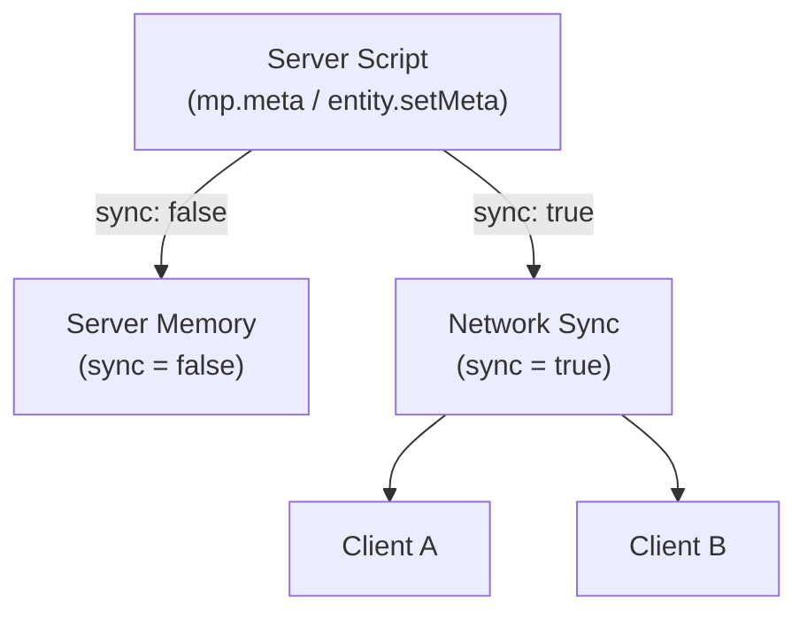

import { Tabs, TabItem } from '@astrojs/starlight/components';
import { SCRIPT_LANG_TAB_SYNC_KEY } from '../../../../lib/const';

The metadata system provides a key-value data storage layer. Rather than creating custom network packets and event handlers for every piece of dynamic game state (such as player money, roles, vehicle fuel, or global weather), metadata allows binding arbitrary values that can optionally synchronize across the network.

In this guide, you will learn how to use global, player, and entity metadata in JavaScript and Lua.

---

## How Metadata Works

Metadata can be attached to individual entities (players, vehicles, objects) or stored at the global server scope.



### The `sync` Flag

When setting metadata, you can provide an optional `sync` boolean parameter:

- **`sync = false` (default):** Stores data **only on the server**. Clients cannot access or read this data. Ideal for sensitive state such as database IDs, admin privileges, or anti-cheat flags.
- **`sync = true`:** Automatically serializes and synchronizes the value to connected clients streaming that entity. Ideal for UI titles, health bars, nametags, and vehicle lock states.

---

## Global Metadata

Global metadata stores server-wide data accessible across all server scripts and optionally replicated to all clients:

<Tabs syncKey={SCRIPT_LANG_TAB_SYNC_KEY}>
  <TabItem label="JS">
    ```js title="server.js"
    // Set global metadata (synced to all connected clients)
    mp.meta.setGlobalMeta('serverTime', '22:45', true);
    mp.meta.setGlobalMeta('activeWeather', 'Rain', true);

    // Set server-only internal metadata
    mp.meta.setGlobalMeta('databaseLatency', 14.2, false);

    // Read global metadata
    const weather = mp.meta.getGlobalMeta('activeWeather');
    console.log(`Current weather: ${weather}`);
    ```
  </TabItem>
  <TabItem label="Lua">
    ```lua title="server.lua"
    -- Set global metadata (synced to all connected clients)
    mp.meta.setGlobalMeta('serverTime', '22:45', true)
    mp.meta.setGlobalMeta('activeWeather', 'Rain', true)

    -- Set server-only internal metadata
    mp.meta.setGlobalMeta('databaseLatency', 14.2, false)

    -- Read global metadata
    local weather = mp.meta.getGlobalMeta('activeWeather')
    print(string.format("Current weather: %s", weather))
    ```
  </TabItem>
</Tabs>

### Listening to Global Meta Changes

Whenever a global key is modified, the server triggers `globalMetaChange`:

<Tabs syncKey={SCRIPT_LANG_TAB_SYNC_KEY}>
  <TabItem label="JS">
    ```js title="server.js"
    mp.events.on('globalMetaChange', (id, key, oldValue, newValue) => {
      console.log(`[Global Meta] Key '${key}' changed from '${oldValue}' to '${newValue}'`);
    });
    ```
  </TabItem>
  <TabItem label="Lua">
    ```lua title="server.lua"
    mp.events.on('globalMetaChange', function(id, key, oldValue, newValue)
      print(string.format("[Global Meta] Key '%s' changed from '%s' to '%s'", key, tostring(oldValue), tostring(newValue)))
    end)
    ```
  </TabItem>
</Tabs>

---

## Player Metadata

Player metadata stores custom data associated with individual connected players:

<Tabs syncKey={SCRIPT_LANG_TAB_SYNC_KEY}>
  <TabItem label="JS">
    ```js title="server.js"
    mp.events.on('playerConnected', (playerId) => {
      const player = mp.players.at(playerId);

      // Server-only data (not synced to clients)
      player.setMeta('dbId', 1042, false);
      player.setMeta('isAdmin', true, false);

      // Synced data (visible to clients for UI / nametags)
      player.setMeta('faction', 'Moxes', true);
      player.setMeta('reputation', 450, true);
    });

    // Reading player metadata
    mp.commands.add('stats', (player) => {
      const faction = player.getMeta('faction') || 'None';
      const rep = player.getMeta('reputation') || 0;
      player.emit('chat:addMessage', `Faction: ${faction} | Reputation: ${rep}`);
    });
    ```
  </TabItem>
  <TabItem label="Lua">
    ```lua title="server.lua"
    mp.events.on('playerConnected', function(playerId)
      local player = mp.players.at(playerId)

      -- Server-only data (not synced to clients)
      player:setMeta('dbId', 1042, false)
      player:setMeta('isAdmin', true, false)

      -- Synced data (visible to clients for UI / nametags)
      player:setMeta('faction', 'Moxes', true)
      player:setMeta('reputation', 450, true)
    end)

    -- Reading player metadata
    mp.commands.add('stats', function(player)
      local faction = player:getMeta('faction') or 'None'
      local rep = player:getMeta('reputation') or 0
      player:emit('chat:addMessage', string.format("Faction: %s | Reputation: %s", faction, rep))
    end)
    ```
  </TabItem>
</Tabs>

### Listening to Player Meta Changes

<Tabs syncKey={SCRIPT_LANG_TAB_SYNC_KEY}>
  <TabItem label="JS">
    ```js title="server.js"
    mp.events.on('playerMetaChange', (playerId, key, oldValue, newValue) => {
      console.log(`[Player ${playerId}] Meta '${key}' changed to: ${newValue}`);
    });
    ```
  </TabItem>
  <TabItem label="Lua">
    ```lua title="server.lua"
    mp.events.on('playerMetaChange', function(playerId, key, oldValue, newValue)
      print(string.format("[Player %s] Meta '%s' changed to: %s", playerId, key, tostring(newValue)))
    end)
    ```
  </TabItem>
</Tabs>

---

## Entity Metadata (Vehicles, Objects, Peds)

You can attach metadata to vehicles, objects, and peds:

<Tabs syncKey={SCRIPT_LANG_TAB_SYNC_KEY}>
  <TabItem label="JS">
    ```js title="server.js"
    // Synced vehicle state
    vehicle.setMeta('isLocked', true, true);
    vehicle.setMeta('fuel', 85.5, true);

    // Server-only data
    vehicle.setMeta('ownerDbId', 42, false);

    // Reading back
    if (vehicle.getMeta('isLocked')) {
      console.log(`Vehicle #${vehicle.id} is locked.`);
    }
    ```
  </TabItem>
  <TabItem label="Lua">
    ```lua title="server.lua"
    -- Synced vehicle state
    vehicle:setMeta('isLocked', true, true)
    vehicle:setMeta('fuel', 85.5, true)

    -- Server-only data
    vehicle:setMeta('ownerDbId', 42, false)

    -- Reading back
    if vehicle:getMeta('isLocked') then
      print(string.format("Vehicle #%s is locked.", vehicle.id))
    end
    ```
  </TabItem>
</Tabs>

### Listening to Entity Meta Changes

<Tabs syncKey={SCRIPT_LANG_TAB_SYNC_KEY}>
  <TabItem label="JS">
    ```js title="server.js"
    mp.events.on('entityMetaChange', (entityId, key, oldValue, newValue) => {
      console.log(`[Entity #${entityId}] Meta '${key}' updated.`);
    });
    ```
  </TabItem>
  <TabItem label="Lua">
    ```lua title="server.lua"
    mp.events.on('entityMetaChange', function(entityId, key, oldValue, newValue)
      print(string.format("[Entity #%s] Meta '%s' updated.", entityId, key))
    end)
    ```
  </TabItem>
</Tabs>
